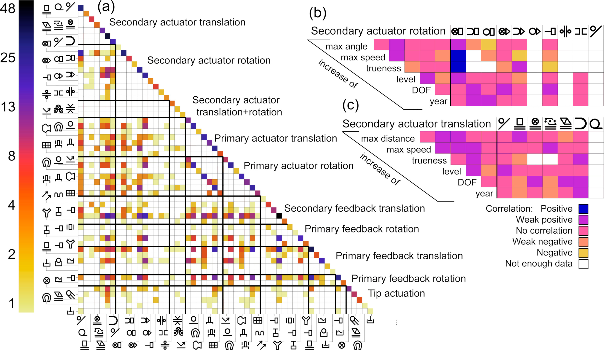
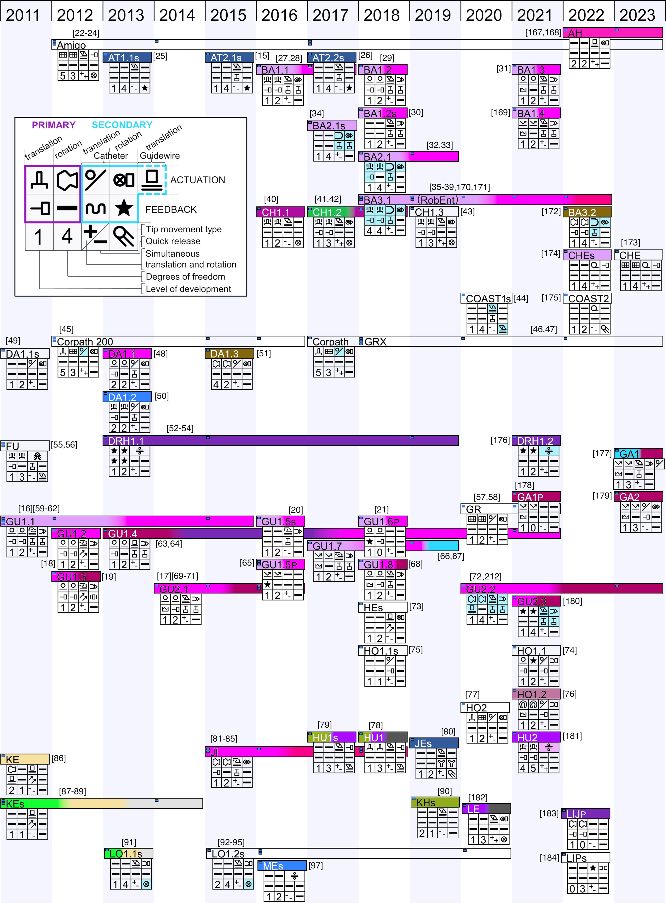
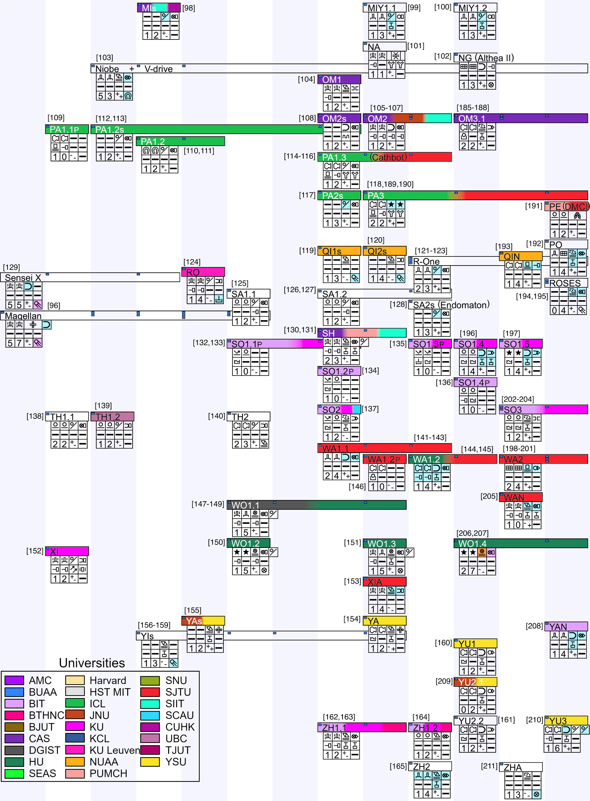
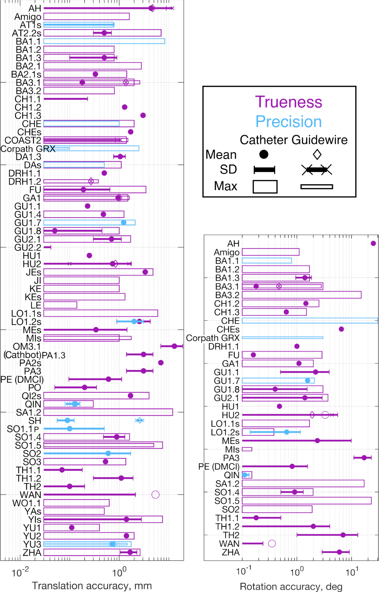

# Robotic catheter mechanisms: review data analysis

Data processing, statistics and figures for the systematic review:

> Belikov N.V., Khaydukova I.V., Poludkin I.E., Borde A.S. (2024). *Evolution and current state of robotic catheters for endovascular surgery: A comprehensive review.* Engineering Science and Technology, an International Journal, 57, 101789. Open access. [doi:10.1016/j.jestch.2024.101789](https://doi.org/10.1016/j.jestch.2024.101789)

The review follows PRISMA 2020: 1,500 records were screened, and 197 reports were included, describing 130 versions of 57 robotic catheter models. Every version was described by the mechanisms it uses, from a classification built for the review, and by its quantitative parameters: ranges of motion, speeds and accuracy.

## How the data was processed

Data on each robotic catheter version was entered into per-article tables, manually or automatically. The code parses these tables into one dataset, encodes the mechanisms and builds the review's statistics and figures. When the tables were updated, rerunning the code rebuilt the figures.

This repository holds the analysis notebook and a working snapshot of the merged dataset (February 2023, 99 versions). The published review uses the final, larger dataset.

## Data

| File | Contents |
|---|---|
| `df10_2 3.csv` | Mechanisms and features of each robotic catheter version (snapshot: 99 versions, 2011–2021) |
| `Korrelyatsia_dannye.xlsx` | Quantitative parameters: maximum translation and rotation, translation and rotation speed, and related values |
| `*.png`, `pici/` | Pictogram for each mechanism type from the review's classification, used as axis labels |

### Columns

A robotic catheter has a **primary** (master) unit next to the surgeon and a **secondary** (slave) unit that moves the instrument. Each unit has an **actuation** channel and a **feedback** channel, along a **translational** and a **rotational** degree of freedom. The column names encode this:

| Column | Unit | Channel | Degree of freedom |
|---|---|---|---|
| `stt` | secondary | actuation | translation |
| `str` | secondary | actuation | rotation |
| `sr` | secondary | actuation | translation and rotation by one mechanism |
| `mtt` | primary | actuation | translation |
| `mtr` | primary | actuation | rotation |
| `sft` | secondary | feedback | translation |
| `sfr` | secondary | feedback | rotation |
| `mft` | primary | feedback | translation |
| `mfr` | primary | feedback | rotation |
| `tt` | catheter tip | actuation | bending |

Values are mechanism codes from the review's classification (Fig. 3 of the paper). `no` means the mechanism is not implemented or not reported; `exc` marks an exception from the classification (⋆ in the paper).

Other columns: `level` is the level of development (0 = 3D model only, up to 5 = commercialised), `dof` is the number of degrees of freedom of the secondary unit, `both_moves` is simultaneous translation and rotation, `qcks` is quick release, `year1` and `year2` are the years of the first and latest reviewed publication.

## What the notebook does

1. One-hot encodes the mechanism codes of every version (scikit-learn `OneHotEncoder`).
2. Counts how often each pair of mechanisms appears in the same robotic catheter and draws the result as a log-scaled heatmap with pictograms on the axes (Fig. 9a).
3. Correlates the use of each secondary-unit mechanism with quantitative parameters and groups the coefficients into five classes: negative, weak negative, none, weak positive, positive, with thresholds at 0.1 and 0.3 (Fig. 9b, c).
4. Plots the distribution of mechanism types over the years.

In the published version, correlations between quantitative parameters use the Pearson coefficient, and correlations between mechanisms and parameters use the Kendall rank coefficient (Section 7 of the paper).

## Figures from the paper

**Fig. 9.** (a) How often mechanisms are implemented together in the same robotic catheter. (b, c) Correlation between the use of secondary-unit mechanisms for rotation (b) and translation (c) and an increase in quantitative parameters.

<p align="center">
  
</p>

**Fig. 5 and 6.** Timeline of robotic catheter evolution: every version with its mechanisms and features.





**Fig. 8.** Accuracy of robotic catheters in translation and rotation: trueness and precision.

<p align="center">
  
</p>

Figures reproduced from the open-access article, © 2024 The Authors, published by Elsevier B.V. under a Creative Commons license.

## Running it

```bash
pip install pandas numpy matplotlib seaborn scikit-learn openpyxl pillow joypy heatmapz
jupyter notebook Robotic_catheter_review.ipynb
```

## Author

Ilia Poludkin (published as Ilya E. Poludkin). Contribution to the review (CRediT): formal analysis, software, visualization, writing of the original draft.
[Google Scholar](https://scholar.google.com/citations?user=x5zcWz0AAAAJ) · [ORCID](https://orcid.org/0000-0003-3198-3612) · [LinkedIn](https://linkedin.com/in/polilya)
